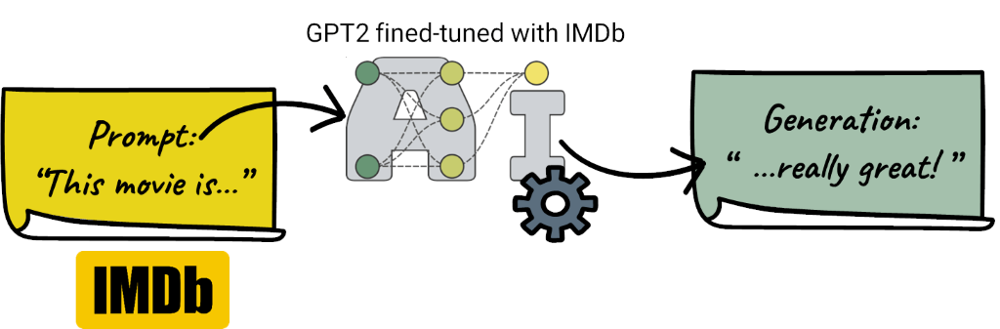

# Reinforcement Learning for Positive-Sentiment Review Generation with GPT2

This project explores how Reinforcement Learning (RL) can be used to steer a language model towards generating positive movie reviews.

Using GPT2 as a text generation model and a BERT variant as a sentiment-based reward model, this notebook demonstrates how Proximal Policy Optimization (PPO) can optimize text generation according to a reward signal.

## Concepts covered

- Text generation with GPT2
- Sentiment classification with DistillBERT
- Reward modeling
- Reinforcement Learning and PPO
- Policy optimization and KL divergence
- Reward hacking and its limitations

## Technologies used

- Python
- PyTorch
- Hugging Face Transformers
- Hugging Face TRL

## Learning objectives

Understand how reinforcement learning can be applied to Large Language Models (LLMs), and explore the challenges of optimizing generative models using automated reward signals.

## Licensing

This notebook was developed for [NXV](https://nxv.fr).

[![CC BY-NC-SA 4.0][cc-by-nc-sa-shield]][cc-by-nc-sa]

This work is licensed under a
[Creative Commons Attribution-NonCommercial-ShareAlike 4.0 International License][cc-by-nc-sa].

[![CC BY-NC-SA 4.0][cc-by-nc-sa-image]][cc-by-nc-sa]

[cc-by-nc-sa]: http://creativecommons.org/licenses/by-nc-sa/4.0/
[cc-by-nc-sa-image]: https://licensebuttons.net/l/by-nc-sa/4.0/88x31.png
[cc-by-nc-sa-shield]: https://img.shields.io/badge/License-CC%20BY--NC--SA%204.0-lightgrey.svg